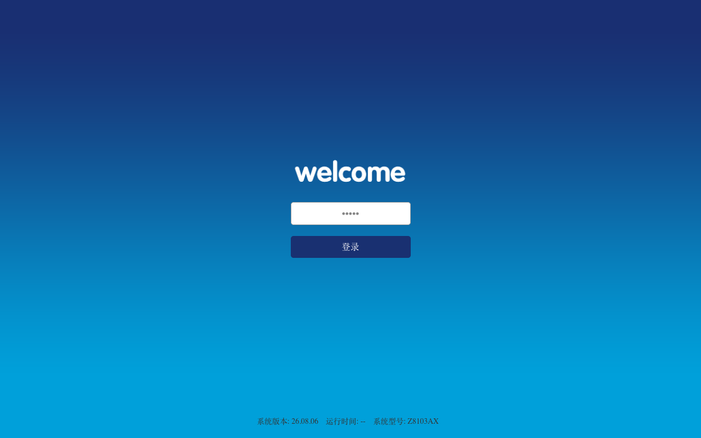
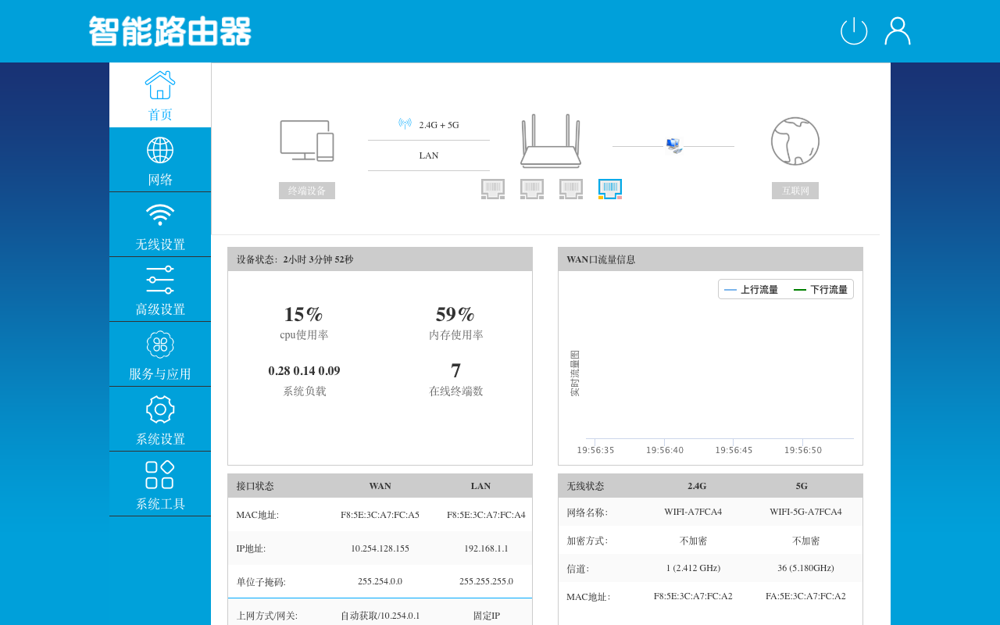
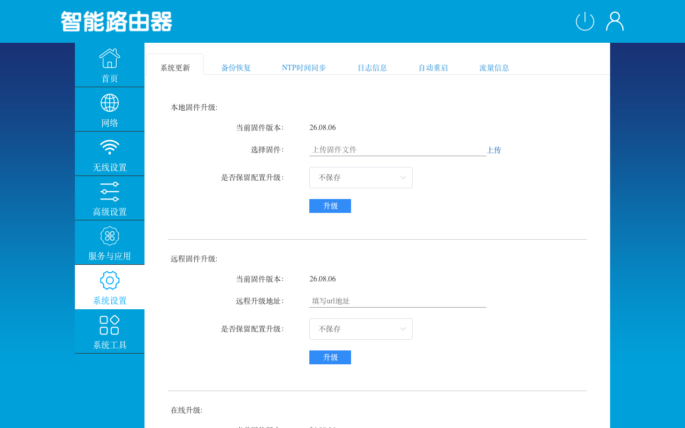
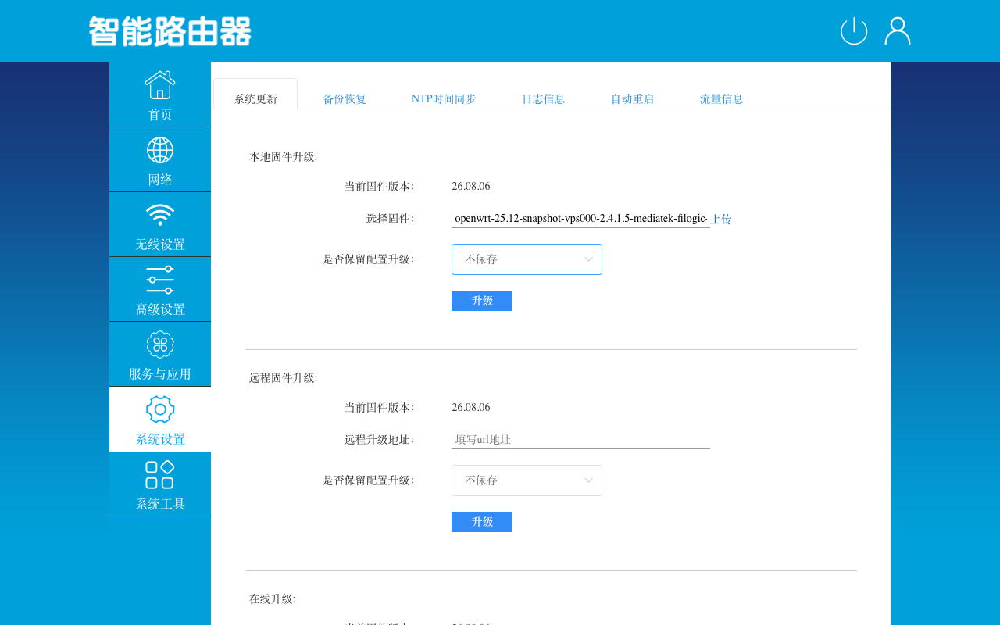
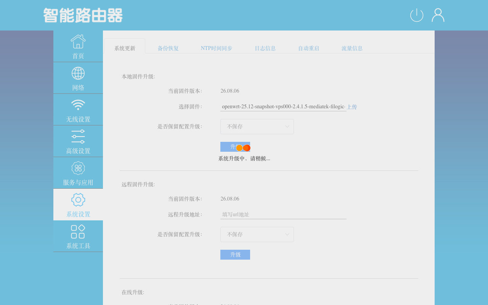
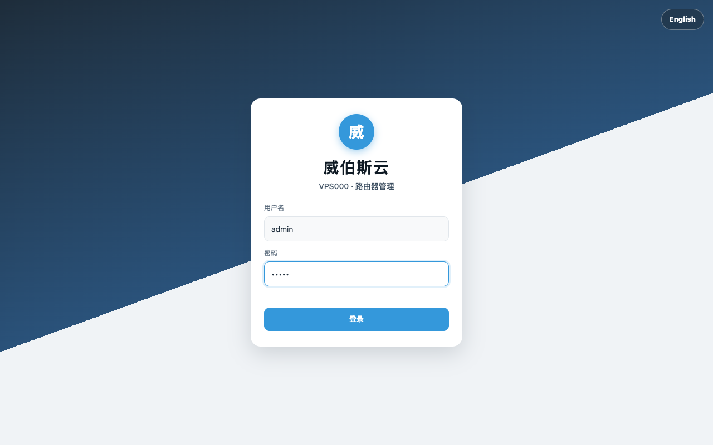
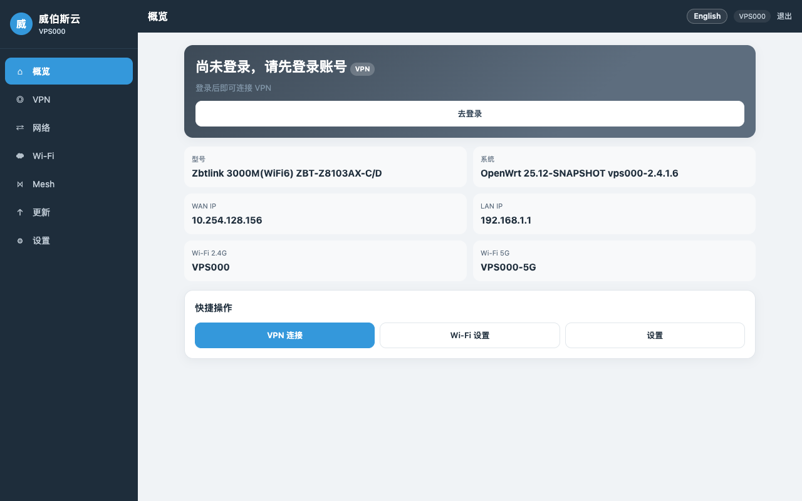
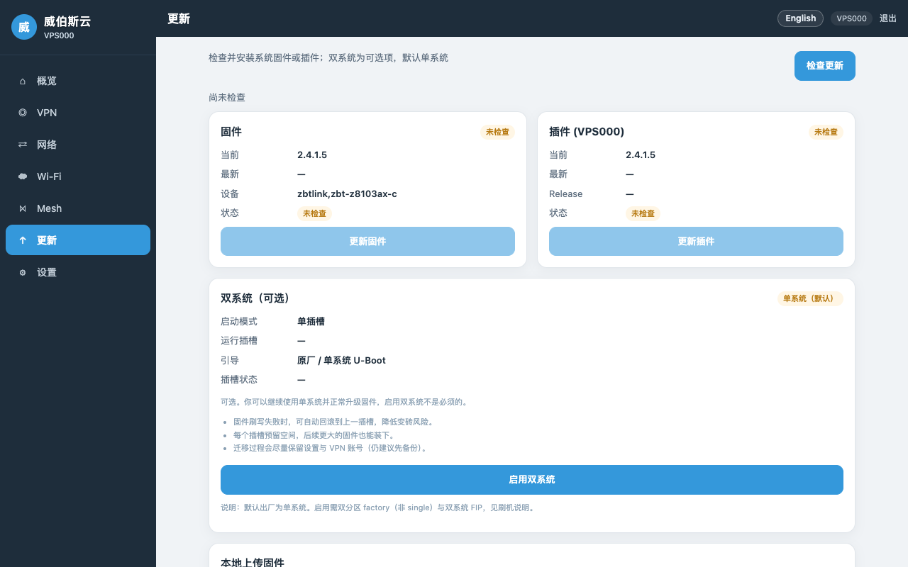

# ZBT-Z8103AX 原厂 Web 刷 VPS000 图文教程

适用：**ZBT-Z8103AX-C / D**，原厂固件（实测 **26.08.06**）→ **VPS000 2.4.1.6**。  
全程只用浏览器，约 **10 分钟**（其中等待重启 3～5 分钟）。以下截图均来自一台真实设备的实际刷机过程。

> ⚠️ **刷写过程中切勿断电、拔网线或关闭电脑**。如原厂页面拒绝升级包，请改用 [U-Boot 备用方法](cpe-flash.md#备用路径-bu-boot-resetfailsafe)。

## 0. 准备

### 下载固件

到发布页 **[cpe-z8103ax-v2.4.1.6](https://github.com/VPS668/clients/releases/tag/cpe-z8103ax-v2.4.1.6)** 下载文件名以 **`-oem-web-sysupgrade.bin`** 结尾的那个：

[openwrt-25.12-snapshot-vps000-2.4.1.6-mediatek-filogic-zbtlink_zbt-z8103ax-c-oem-web-sysupgrade.bin](https://github.com/VPS668/clients/releases/download/cpe-z8103ax-v2.4.1.6/openwrt-25.12-snapshot-vps000-2.4.1.6-mediatek-filogic-zbtlink_zbt-z8103ax-c-oem-web-sysupgrade.bin)

> 不要下载 `factory` 或普通 `squashfs-sysupgrade`，那是给 U-Boot / 已刷 VPS000 的设备用的。

### 校验 sha256

正确值：

```
0904a920a905907f370c57e799c64a1f6402d428dcdd3bff917c056116de39c2
```

- macOS / Linux：`shasum -a 256 文件名.bin`
- Windows（PowerShell）：`Get-FileHash .\文件名.bin -Algorithm SHA256`

结果与上面**完全一致**才继续；不一致请重新下载。

### 连接设备

- 用网线接 CPE 的 **LAN 口**，或连接原厂 Wi‑Fi（如 `WIFI-5G-XXXXXX`）。
- 浏览器打开 **http://192.168.1.1**。
- 若你家路由器也是 192.168.1.1，请先断开其它网络，确保打开的是 CPE 页面。

## 1. 登录原厂后台

输入管理密码（出厂默认 **admin**，以机身标签为准），点「登录」。页面底部能看到当前系统版本（此例 26.08.06）。



## 2. 首页确认型号和版本

登录后在首页底部确认 **系统型号：Z8103AX**，并记下 MAC 地址，便于之后识别本机 Wi‑Fi。



## 3. 打开「系统设置 → 系统更新」

左侧点「系统设置」，默认就是「系统更新」页，使用最上面的 **本地固件升级**。



## 4. 选择固件，并设为「不保存」配置

1. 点「选择固件」右侧的 **上传**，选择刚下载的 `*-oem-web-sysupgrade.bin`。
2. 「是否保留配置升级」选 **不保存**（原厂配置与 VPS000 不兼容）。
3. 确认文件名正确后点 **升级**。



## 5. 等待升级完成（3～5 分钟）

页面显示「系统升级中，请稍候…」。此时**不要断电、不要刷新、不要关页面**。  
设备写入完成后会自动重启，原厂 Wi‑Fi 消失，指示灯可能闪烁，属正常现象。



## 6. 连接新 Wi‑Fi，登录 VPS000

约 3～5 分钟后会出现新的 Wi‑Fi：**`VPS000`**（2.4G）/ **`VPS000-5G`**（5G），**默认无密码**。  
连接后（有线用户无需操作）浏览器打开 **http://192.168.1.1**，会自动进入 VPS000 管理界面。用户名/密码 **admin / admin**。

> 附近可能有别人的同名 `VPS000` 热点，请靠近本机连接，并以登录后显示的信息为准。



## 7. 概览页确认版本

「系统」一栏显示 **OpenWrt 25.12-SNAPSHOT vps000-2.4.1.6** 即刷机成功。未登录账号时概览页顶部显示「尚未登录，请先登录账号」，点「去登录」进入「VPN」页填写账号即可连接线路。



## 8. 更新页（以后在线升级）

以后升级固件或插件，在「更新」页点 **检查更新** 即可，无需再走原厂流程。双系统为可选项，默认单系统，不需要启用。



## 刷完后请立即

- 在「Wi‑Fi」页给 `VPS000` / `VPS000-5G` **设置密码**；
- 在「设置」页**修改管理密码**。

## 常见问题

| 现象 | 处理 |
|------|------|
| 点「升级」后提示文件类型无效 / 上传失败 | 确认下载的是 `-oem-web-sysupgrade.bin` 且 sha256 正确；仍失败请改用 [U-Boot 备用方法](cpe-flash.md#备用路径-bu-boot-resetfailsafe) |
| 等了 10 分钟仍没有 `VPS000` Wi‑Fi | 先用网线接 LAN 口访问 http://192.168.1.1；仍无法访问再断电重启一次。若依然不行，按 [U-Boot 备用方法](cpe-flash.md#备用路径-bu-boot-resetfailsafe) 用 `factory-single.bin` 恢复 |
| 打开 192.168.1.1 是别的页面 | 电脑同时连了其它也用 192.168.1.1 的网络，断开其它网络后重试 |
| 升级过程中意外断电 | 不要反复上电尝试，直接按 [U-Boot 备用方法](cpe-flash.md#备用路径-bu-boot-resetfailsafe) 处理 |

完整技术说明（各固件区别、验签原理、U-Boot 恢复）：**[cpe-flash.md](cpe-flash.md)**
