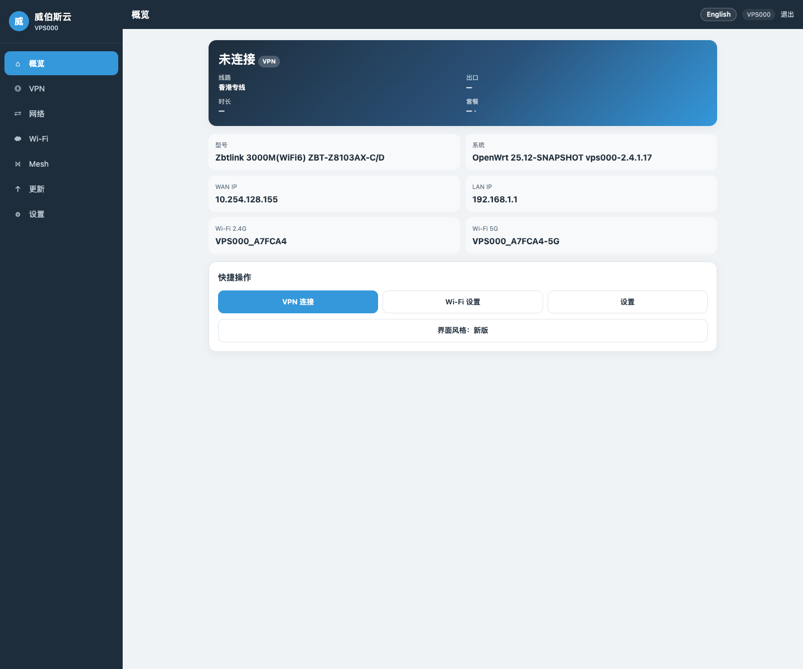
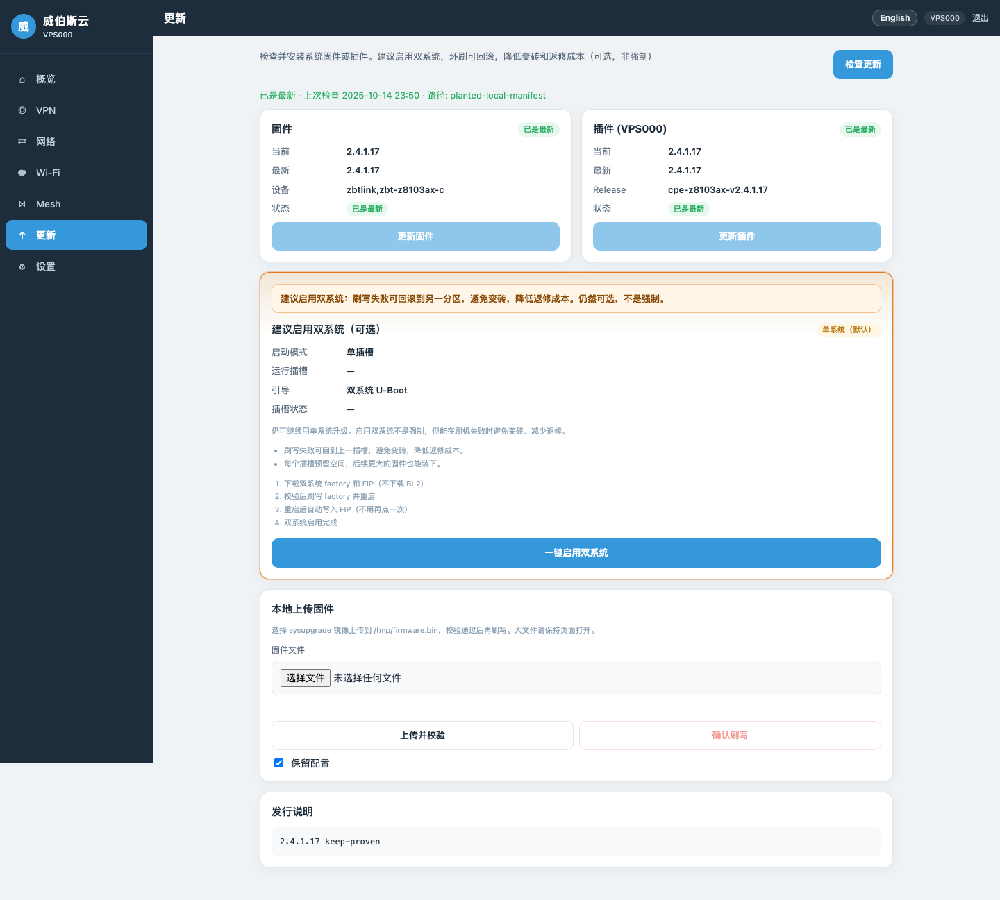
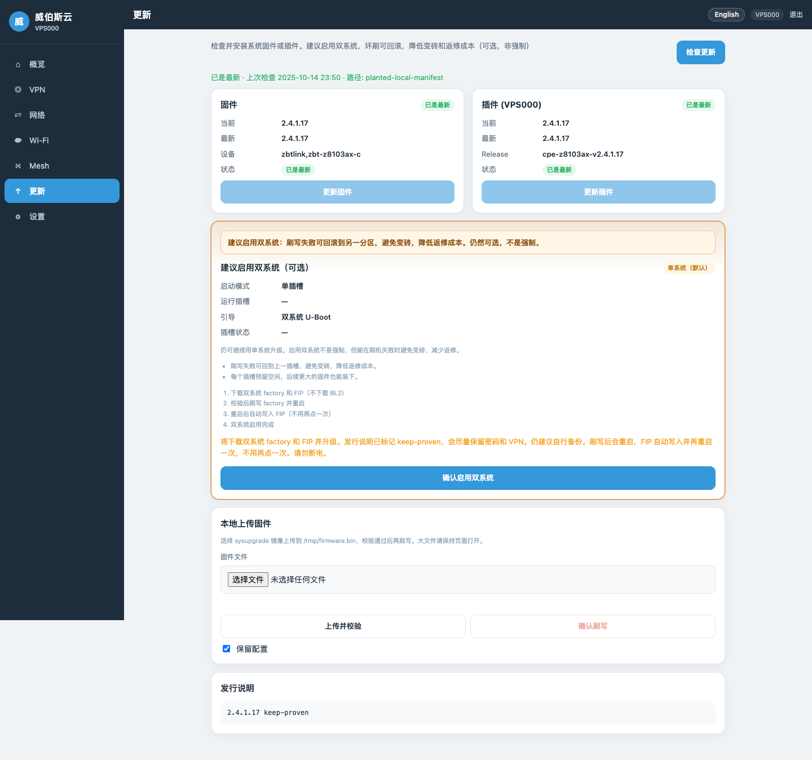
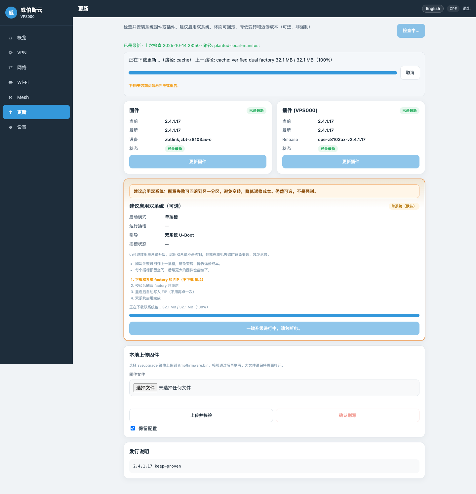
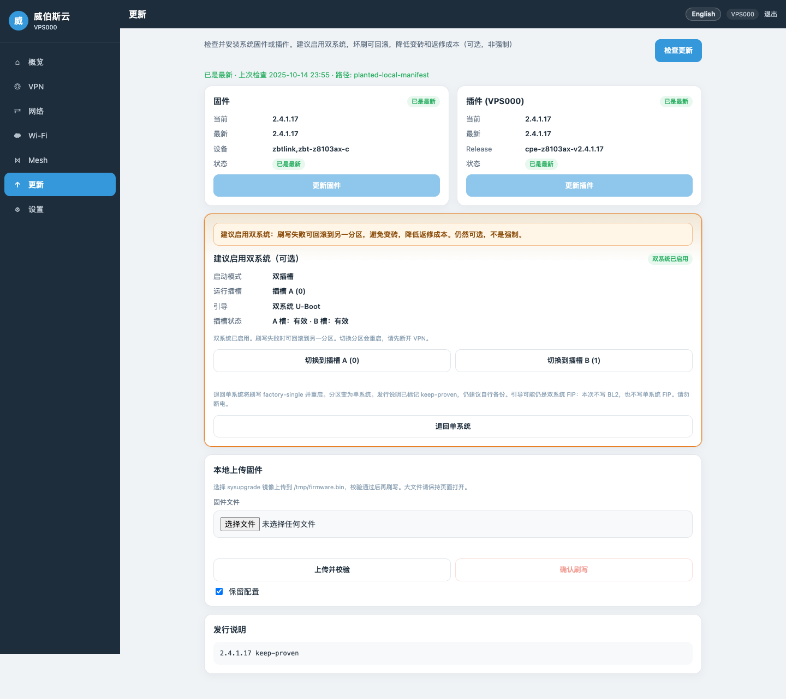
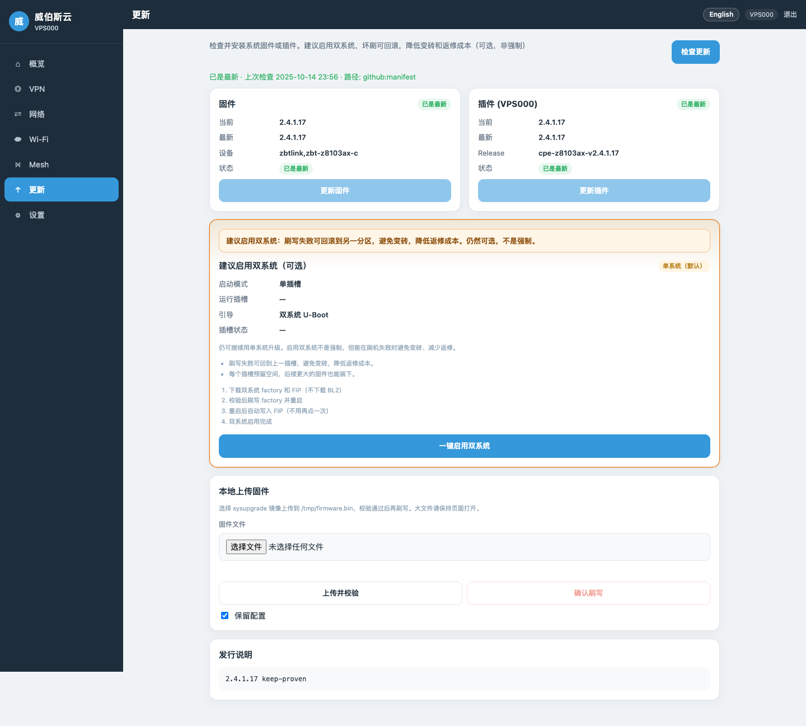

# ZBT-Z8103AX 一键双系统 / 退回单系统 图文教程

适用：已刷 **VPS000 ≥ 2.4.1.17** 的 **ZBT-Z8103AX-C / D**。  
全程在管理界面「更新」页操作，约 **5～10 分钟**（含重启等待）。双系统为**可选项**，默认单系统；本教程按「建议启用」路径说明。

> ⚠️ **刷写 / 启用双系统 / 退回单系统 / 恢复出厂过程中切勿断电**。页面会先执行准备重启（干净断开 VPN），无需也不要自行跑任何命令行。  
> 📷 截图占位：当前设备处于首次改密门禁，本版以 `
` 标明待补图；文件名见文末与 `docs/images/cpe-one-click-dual/`。

相关发布与校验：[cpe-z8103ax-v2.4.1.17](https://github.com/VPS668/clients/releases/tag/cpe-z8103ax-v2.4.1.17) · sha256 见 **[cpe-flash.md](cpe-flash.md)（文内「v2.4.1.17 文件校验（sha256）」）**。  
原厂首次刷机请看：[原厂 Web 刷机图文教程](cpe-flash-oem-web-illustrated.md)。

## 0. 准备

1. **固件版本**：概览页「系统」应显示 **vps000-2.4.1.17**（或更高）。低于此版本请先在「更新」页做**保留配置**升级到 2.4.1.17。保留配置升级**不会**重置 Web/root 密码，也**不会**清空已设 Wi‑Fi。
2. **访问方式**：电脑连 CPE 的 **LAN 口**，或连本机 Wi‑Fi（`VPS000_<MAC后6位>` / `-5G`）。浏览器打开 **http://192.168.1.1**，登录管理界面。
3. **备份建议**：一键双系统与退回单系统在 **keep-proven** 发行说明下会尽量保留密码与 VPN 账号，仍建议自行记下账号与 Wi‑Fi 设置。
4. **资源说明**：一键双系统会从更新通道下载**双分区 factory（非 single）** 与 **FIP**（不写 BL2）。像 A7FCA4 这类机型走 **FIP 路径**即可，不必再单独做「工厂双系统」作为主流程。退回单系统使用清单中的 **factory-single**。完整文件与 sha256 见 [cpe-flash.md](cpe-flash.md)（文内「v2.4.1.17 文件校验（sha256）」） 与发布页。

## 1. 打开「更新」页，阅读双系统建议

左侧点 **「更新」**。页眉会说明：双系统**建议启用**（坏刷可回滚，降低变砖与返修成本），但仍是**可选、非强制**。

页面中部有 **「建议启用双系统（可选）」** 卡片。单系统时状态多为 **单系统（默认）**，启动方式为单插槽；引导可能显示原厂/单系统 U-Boot，或已具备双系统能力的 FIP（分区仍是单系统布局时也会如此）。

## 2. 一键启用双系统

1. 在双系统卡片点 **「一键启用双系统」**（确认后按钮文案可能变为「确认启用双系统」）。
2. 确认对话框会说明：将下载双系统 **factory** 与 **FIP**；**2.4.1.17** 发行说明已标记 **keep-proven**，会尽量保留密码和 VPN，仍建议备份；刷写后会重启，**FIP 自动写入**，无需再点一次、也不用再点「检查更新」。请勿断电。
3. 点确认后，界面进入「一键升级进行中，请勿断电。」后台会先 **prepare-reboot**（干净断开 VPN），再下载并刷写。进度可能显示「正在下载双系统包…」。

## 3. 等待重启，确认双系统已启用（DONE）

按 GOGOGO 风格：**一键包已含 FIP**，完成刷写并重启后应进入双系统。若页面提示分区已刷好、FIP 正在自动写入并再重启一次——属自动步骤，**不要再点按钮**，勿断电。

重启完成后重新打开 **http://192.168.1.1** →「更新」页。双系统卡片状态应为 **「双系统已启用」**（内部状态 **DONE**）：可看到双插槽信息；引导为双系统 U-Boot。刷写失败时可回滚到另一分区。

## 4. 退回单系统（可选）

同一「更新」页（或设置相关区域的同一套更新能力）在已启用双系统时提供 **「退回单系统」**：

1. 点 **「退回单系统」** 并确认。将下载并刷写清单中的 **factory-single**，然后重启。  
2. 同样会先 **prepare-reboot** 断开 VPN。keep-proven 下仍建议备份。  
3. **本次不写 BL2，也不写单系统 FIP**。退回后分区布局为 **SINGLE / NEED_FACTORY**；闪存上的 FIP **可能仍保持双系统能力**（仅布局回到单系统），属正常现象。

## 5. 常见问题

| 现象 | 处理 |
|------|------|
| 以前报「FIP 下载失败」 | **2.4.1.17** 已修复：布局检查只记录 FIP 状态，sha256 相符的缓存直接复用，不再误报下载失败。请先升级到 2.4.1.17 再一键启用。 |
| 一键过程中断网 / VPN 断开 | 正常：刷写前会自动准备重启并断开 VPN，无需手动处理。 |
| 按钮灰色 /「缺少双系统包」「请先检查更新」 | 先点「检查更新」，确认发布清单含双系统 factory 与 FIP；网络需能访问 GitHub 发布通道。 |
| 「清单里没有 factory-single」 | 退回单系统需要发布页的 factory-single；不会用双系统 factory 冒充单系统。请使用 [2.4.1.17 发布页](https://github.com/VPS668/clients/releases/tag/cpe-z8103ax-v2.4.1.17) 对应清单。 |
| 重启后仍显示单系统 | 再等 1～2 分钟刷新「更新」页；若 FIP 自动写入未完成，可再点一次「一键启用双系统」仅补写 FIP（不刷 factory、不写 BL2）。仍异常请联系售后，**不要**自行拆机或乱刷 BL2。 |
| 其它卡住 / 无法进系统 | **联系售后支持**。本教程不提供危险救援步骤；技术背景见 [cpe-flash.md](cpe-flash.md) 备用路径说明（仅在支持指导下使用）。 |

## 截图文件清单

放到 `docs/images/cpe-one-click-dual/`：

| 文件名 | 内容 |
|--------|------|
| `01-overview-version.png` | 概览页，版本 ≥ 2.4.1.17 |
| `02-update-recommend-dual.png` | 更新页：建议启用双系统横幅 + 卡片（单系统默认） |
| `03-confirm-enable-dual.png` | 「确认启用双系统」对话框（含 FIP / keep-proven） |
| `04-dual-in-progress.png` | 下载或刷写进行中 |
| `05-dual-done.png` | 状态「双系统已启用」（DONE） |
| `06-restore-single-button.png` | 「退回单系统」按钮与说明 |
| `07-restore-single-done.png` | 退回后 SINGLE / NEED_FACTORY |

> 补图后删除本段上方各 `
` 注释即可；勿在教程中出现账号口令或内网专用命令。

完整刷机与文件说明：**[cpe-flash.md](cpe-flash.md)**
